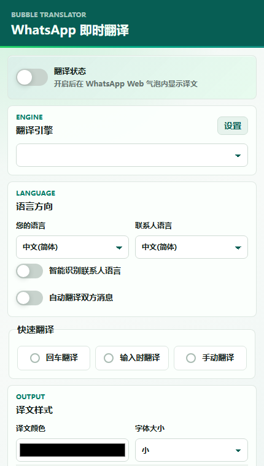
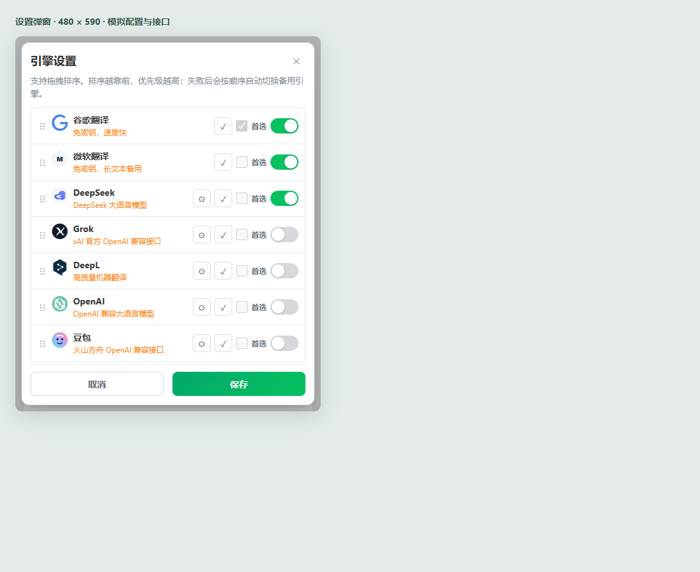
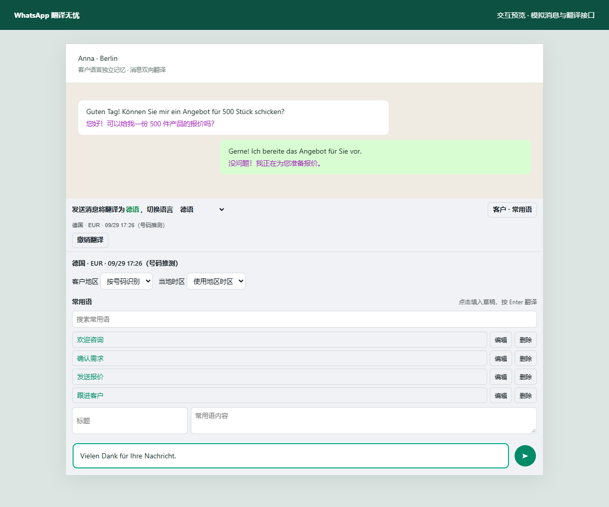
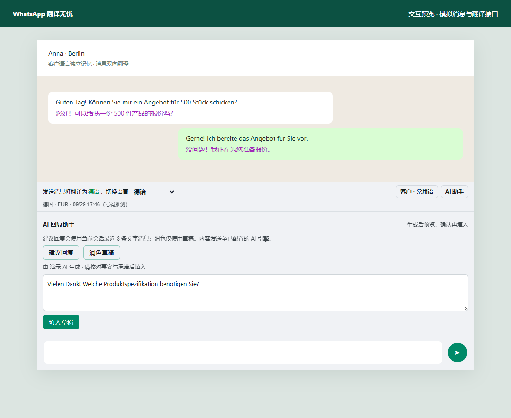

# WhatsApp翻译无忧

**WhatsApp Bubble Translator** 是一个 Chrome Manifest V3 扩展：在 WhatsApp 网页版的原有聊天气泡里翻译消息，原文保留。历史英文名是 WhatsApp Bubble Translator。当前版本 **0.3.3**。

本项目与 WhatsApp / Meta 无关。MIT 许可。

[中文](#中文) · [English](#english) · [隐私政策](docs/PRIVACY.md) · [商店文案](docs/chrome-web-store.md)

## 中文

在聊天气泡内翻译收发消息，适合需要跟进外语客户的场景。支持谷歌、微软、DeepSeek、Grok、DeepL、OpenAI、豆包、Gemini，以及任意 OpenAI 兼容接口。另有 AI 回复助手、客户语言、地区时间和常用语。

### 功能摘要

- 译文写在原气泡里，默认紫色，可改颜色和字号
- 回车先翻译再发送，或输入时翻译；可选翻译完成后直接发送
- 按客户记住语言；显示地区、货币和当地时间；常用语一键填入
- 多引擎排序，失败后自动换下一个；可测试接口、拉取模型
- AI 助手根据最近消息草拟回复，或润色当前草稿；确认后才填入，不自动发送

### 安装

**加载已解压的扩展**

1. 打开 `chrome://extensions/`，开启「开发者模式」
2. 选择「加载已解压的扩展程序」，选中含 `manifest.json` 的目录
3. 打开 [WhatsApp 网页版](https://web.whatsapp.com/) 并登录
4. 点击工具栏上的扩展图标，打开翻译开关

更新代码后，在扩展页重新加载，确认版本为 **0.3.3**，再刷新 WhatsApp 页面。

**Chrome 网上应用店**

尚未上架。上架后把下面的占位链接换成实际地址：

`https://chromewebstore.google.com/detail/TODO-whatsapp-bubble-translator`

商店用的名称、短说明、权限理由和截图图注在 [docs/chrome-web-store.md](docs/chrome-web-store.md)。

**打商店压缩包**

```bash
npm run pack
```

需要系统已安装 `zip`。输出在 `dist/whatsapp-bubble-translator-0.3.3-chrome-web-store.zip`，不含测试、文档、预览图和 `node_modules`。

### 截图

| 弹窗 | 引擎设置 |
| --- | --- |
|  |  |

| 气泡翻译与客户工具 | AI 助手 |
| --- | --- |
|  |  |

开发用的失败重试预览（模拟页面，不是商店截图）：[tests/error-recovery-0.3.2.png](tests/error-recovery-0.3.2.png)。

### 隐私

待译文本会发送到你启用的翻译服务。谷歌翻译和微软翻译默认开启；谷歌直连失败时，同一段文本可能同时发给 MyMemory。AI 建议回复会带上最近最多 8 条文字消息。

作者没有服务器，不在自己的服务器上保存聊天记录，也不出售数据。密钥、译文缓存、客户语言和常用语只在浏览器扩展存储里；诊断日志不记录原文和密钥。若开启 Chrome 同步，`chrome.storage.sync` 里的设置（含密钥）可能同步到你的 Google 账号。

完整说明：[docs/PRIVACY.md](docs/PRIVACY.md)。不要把真实 API 密钥提交进仓库。

### 贡献与测试

```bash
npm ci
npm test
```

`npm test` 运行扩展回归、输入场景、草稿生命周期、引擎请求和诊断日志测试。欢迎用 Pull Request 提交改进。改动请保持现有行为，并补上对应测试。`tests/preview.html` 是本地模拟页面，不连接真实 WhatsApp。

### 许可

[MIT License](LICENSE)。Copyright (c) 2026 claussenyordanka800-sys and contributors.

## English

WhatsApp Bubble Translator is a Chrome MV3 extension. It translates WhatsApp Web messages inside the original chat bubble and leaves the source text in place. The in-product name is WhatsApp翻译无忧. Version 0.3.3. It is not affiliated with WhatsApp or Meta.

### Features

- In-bubble translation, with color and type size controls
- Enter to translate, Enter again to send; translate-while-typing; optional send-after-translate
- Per-contact language, region, currency, local time, and quick phrases
- Ordered engines: Google, Microsoft, DeepSeek, Grok, DeepL, OpenAI, Doubao, Gemini, and any OpenAI-compatible URL
- AI reply suggestions and draft polishing. You insert the result; it is not sent for you

### Install

Load the unpacked folder that contains `manifest.json` from `chrome://extensions` (Developer mode), then open [WhatsApp Web](https://web.whatsapp.com/).

Chrome Web Store listing is not live yet. Placeholder:

`https://chromewebstore.google.com/detail/TODO-whatsapp-bubble-translator`

`npm run pack` builds `dist/whatsapp-bubble-translator-0.3.3-chrome-web-store.zip` (requires `zip`). Screenshots are in the Chinese section above. Store copy, permission justifications, and captions: [docs/chrome-web-store.md](docs/chrome-web-store.md).

### Privacy

Translation text is sent to the providers you enable. Google and Microsoft are on by default; a failed Google request may also reach MyMemory. No chat data is stored on our servers, and we do not sell data. API keys stay in extension storage and can sync with Chrome if sync is on. Details: [docs/PRIVACY.md](docs/PRIVACY.md). Do not commit real API keys.

### Contributing and tests

```bash
npm ci
npm test
```

Issues and pull requests are welcome. The license is [MIT](LICENSE).

## 详细说明与更新记录

下面保留功能细节和各版本的改动记录。

## 使用

1. 打开 Chrome：`chrome://extensions/`
2. 开启“开发者模式”
3. 点击“加载已解压的扩展程序”
4. 选择解压后的扩展文件夹（包含 `manifest.json`）
5. 打开 `https://web.whatsapp.com/`

## 功能

- 自动识别当前客户语言，并在输入框上方显示“当前场景语言”
- 可在 WhatsApp 输入框上方手动切换目标语言
- 客户消息和自己发出的消息都会默认自动翻译，不显示额外刷新按钮
- 译文显示在同一个气泡内，紫色，保留原文
- 输入框旁不显示翻译按钮，避免占用 WhatsApp 原生输入栏
- 设置页可调整译文字体大小：小、默认、大、特大
- 设置页可选择译文颜色
- 默认“回车翻译”：输入完整中文后按 Enter，先翻译成客户语言并填入输入框，不发送
- 翻译完成后再次按 Enter，才按 WhatsApp 原逻辑发送
- 设置页可切换为“回车翻译”或“输入时翻译”
- 默认先填入译文；可开启“翻译完成后直接发送”，在按 Enter 或点击发送时翻译后触发发送。输入时翻译不会主动发送。
- 支持 Google、DeepSeek、第三方 OpenAI 兼容 API
- 支持 Grok：填写 xAI API Key，接口地址默认 `https://api.x.ai/v1`，默认模型 `grok-4.5`
- 另支持 DeepL、OpenAI、豆包、Gemini
- 设置页可对翻译引擎上移/下移排序，翻译时按排序优先级自动尝试
- 翻译引擎列表默认紧凑显示，点击齿轮按钮展开 API Key、接口地址、模型配置
- 支持“获取模型”：OpenAI 兼容接口和 Gemini 会读取可用模型供选择
- 支持“测试接口”：保存前可确认 API Key、接口地址、模型是否可用
- DeepSeek 已做专门兼容：Base URL 会自动规范为 `https://api.deepseek.com`，`/models` 获取失败会显示 401/403/404/429 等具体原因
- DeepSeek 默认使用 `deepseek-v4-flash`；保留用户已填写的模型。成功获取模型时采用接口实际返回的列表，内置候选仍需测试确认可用性。
- 消息翻译最多同时处理 3 条；Google 网页入口与 MyMemory 备用翻译并行竞速，失败入口会自动冷却，避免每条消息重复等待
- 引用消息和图片数量不会再被当作正文重复翻译；接口返回 HTML 错误页时只显示简短错误

## 输入与工作场景优化

- 纯数字、手机号、金额、日期、时间、表情、标点、独立链接、邮箱及明确型号（如 `AB-12345`、`SKU2026`）跳过翻译，按 Enter 或点击发送走 WhatsApp 原生行为。包含这些信息的正常句子仍翻译，原始文本不会因判断而改写。
- 消息气泡和客户语言检测同样跳过上述非语言内容，减少请求和错误语言识别。
- 翻译填入后立即编辑能被识别，再按一次 Enter 可发送；长按 Enter 的重复事件不会发送译文预览。Shift+Enter 换行和输入法选词保留原行为，输入法尚未完成时点击发送会被拦截。
- 修改草稿、切换客户、切换语言或关闭插件后，旧请求不再占住草稿状态，也不会覆盖新内容或清掉新请求的忙碌提示。输入时翻译等待输入法完成，并对最新草稿重新计时。
- 回车和发送按钮使用一致的中文发送保护；翻译失败、空结果或写入失败保留草稿、不自动发送，并允许重试。
- 正文中的约定时间（如“明天见 12:30”）保留，WhatsApp 明确标记的消息时间仍排除；嵌套格式文字不重复提取。过期的气泡错误不会插入新会话或已修改的消息。
- 相同内容、方向及引擎配置的并发请求共用一次接口调用；缓存读写或清理失败不会丢弃成功译文。

验证：`npm test` 包含现有回归、60 个输入场景、33 个草稿生命周期场景、7 个设置请求场景，以及诊断日志的环形缓冲、脱敏和弹窗筛选。另用 Chromium 预览页验证发送按钮、异步回填、错误提示和非语言内容。预览使用模拟接口，真实 WhatsApp 的发送及输入框行为仍需登录页面确认。

## 0.3.3：诊断日志

设置页「翻译引擎」旁新增 **日志**。翻译接口失败、超时、空结果、引擎冷却、缓存写入/清理失败、发送按钮点不中、连续发送失败、输入框写回失败和 AI 助手失败会记入 `chrome.storage.local` 的 `wbtDiagLog`（最多 400 条，ISO 时间）。可按级别筛选、复制全部、清空。

日志只保存引擎、状态码、方向、语言、文本长度和短哈希，不保存原文、API Key、Authorization 或请求体。同一引擎的冷却跳过最多每 30 秒记一条，避免把历史错误冲掉。代码审查见 [docs/REVIEW.md](docs/REVIEW.md)。

更新：在 `chrome://extensions` 重新加载扩展，确认版本 **0.3.3**，再刷新 WhatsApp 页面。打开扩展弹窗，点「日志」。

## 0.3.2：DeepSeek Harness 交叉验证修复

- 已填入的译文保留其目标语言，自动识别变化不会导致二次翻译；手动改目标语言从保留原稿翻译。
- 回填等待编辑器确认，区分框架回声和用户编辑。写入校验保留换行，部分写入或格式丢失会显示错误并保留原稿，支持重试和恢复原稿。
- 错误提示独立显示，不遮挡语言选择及工具按钮；连接失效提示刷新 WhatsApp。翻译中点击发送、请求中改语言或设置都有反馈。
- 气泡被重建时复用译文，修改引擎配置后使旧结果失效；扩展实例重载清理旧监听器。
- 设置测试和模型查询忽略过期响应，保存按顺序执行并显示失败原因。保留用户模型，内置模型列表明确标为候选。
- 本地检测可靠时，已是目标语言的草稿不请求接口；可靠识别的西语等拉丁文字可翻译为英语。英语默认下，无法可靠识别的短拉丁文本保留原文。

更新：在 `chrome://extensions` 重新加载扩展，确认版本 **0.3.2**，再刷新 WhatsApp 页面。

## 0.3.1：比例修复与 AI 助手

- 弹窗固定为 480×590，移除导致 Chrome 弹窗宽度收缩的视口规则；引擎列表独立滚动，保存／取消常驻，名称不再竖排。
- 聊天工具栏新增“AI 助手”：建议回复使用最近 8 条文字消息，润色仅使用当前草稿。结果先预览、可编辑，确认后填入，不自动发送。草稿或客户发生变化时阻止覆盖。
- AI 使用已启用且密钥、地址、模型配置完整的 AI 引擎，优先当前选中引擎，其次按列表顺序；Google、微软、DeepL 不用于 AI 生成。设置页显示 AI 配置就绪状态。
- AI 调用和模型查询设 25 秒超时；接口测试检查空结果，并使用当前 AI 翻译要求。取得模型列表后，仍需保存配置。
- 引擎面板统一点击“保存”生效，“取消”恢复打开前配置；去掉模型列表的同步存储，避免列表太大导致配置保存失败。

使用：引擎设置 → 启用 AI 引擎 → 填写密钥、地址与模型 → 测试接口 → 保存。回到 WhatsApp，点击输入框上方“AI 助手”。真实服务是否可用取决于密钥、额度和模型权限；本仓库回归测试使用模拟接口，不代表实际账户已经连通。

## 0.3.0：客户聊天工具

- 客户语言单独保存，自动检测和手动选择均可在刷新后恢复；选择“恢复自动识别”取消手动覆盖。
- 输入框上方常驻显示客户地区、货币、当地日期和时间。“客户 · 常用语”面板可修改地区和时区。
- 号码推测会明确标注；美国／加拿大等共享区号不强行推断，多时区国家需手动选择。群组及不透明联系人 ID 不当作手机号。
- 常用语支持新增、编辑、删除、搜索和一键填入；已有草稿不会被覆盖。最多 100 条，每条最多 2,000 字。
- 新增 AI 翻译要求，适用于 OpenAI 兼容引擎和 Gemini；普通机器翻译引擎不使用此要求。
- 草稿翻译可撤销；翻译失败可点击气泡内错误重试。切换聊天、修改草稿、改变语言或关闭插件后，旧请求不会覆盖当前草稿。
- 关闭自动翻译对双方消息都生效。缓存按方向、模型、接口和翻译要求隔离；清理翻译缓存保留客户资料与常用语。

### 与 WATransChat 的对齐范围

依据：[官网](https://zla5.github.io/) 与 [Chrome 商店](https://chromewebstore.google.com/detail/cgdniobighicnjocimecbcphimoebgbj) 的公开描述。已实现双向翻译、客户语言偏好、地区／货币／时间、快捷短语和多引擎等核心流程；不是原产品代码或界面的逐像素复制。

当前语言选择覆盖 100 多种，地区表覆盖常见外贸市场，尚未达到竞品宣称的 200+ 语言及完整国家覆盖。不同翻译引擎实际支持的语言不同。联系人优先按 WhatsApp 消息中的会话 ID 关联；页面未提供 ID 时退回标题，同名客户存在混淆风险。真实 WhatsApp 页面结构、发送按钮和富文本输入行为仍需登录后验收；找不到发送按钮时会保留译文供手动发送。

客户资料和常用语保存在浏览器本地，清理浏览器扩展数据会删除这些内容。翻译文本会发往启用的翻译服务；接口配置沿用扩展同步设置。

### 验证

运行 `npm ci`、`npm test`。回归覆盖客户偏好持久化、草稿竞态、输入法、发送行为、短语操作及缓存隔离。

`tests/preview.html` 是模拟聊天和模拟翻译接口，可使用本地 HTTP 服务打开进行界面检查；它不连接真实 WhatsApp 或翻译服务。

## Grok API 说明

- 官方 API 是 OpenAI 兼容接口：`https://api.x.ai/v1`
- API Key 在 [xAI Console](https://console.x.ai/) 创建；Grok 网页/APP 的免费套餐与 API 计费账户分开，不能直接当作免费 API 额度。
- 官方 API 当前按量计费。若只想零成本试用，可了解第三方 [Puter.js Grok 接入](https://developer.puter.com/tutorials/free-unlimited-ai-api/)，它是 Puter 的用户付费/平台策略，不是 xAI 官方免费 API，稳定性、隐私和额度都应自行评估。

## 第三方 API 示例

本地 OpenAI 兼容服务：

- 接口地址：`http://127.0.0.1:8000/v1`
- 模型：按你的本地服务填写
- API Key：本地服务不需要时可留空

豆包 Ark 或其他云服务：

- 接口地址填到 `/v1` 或服务根路径均可，只要最终兼容 `/chat/completions`
- API Key 填对应密钥
- 模型填对应模型名
